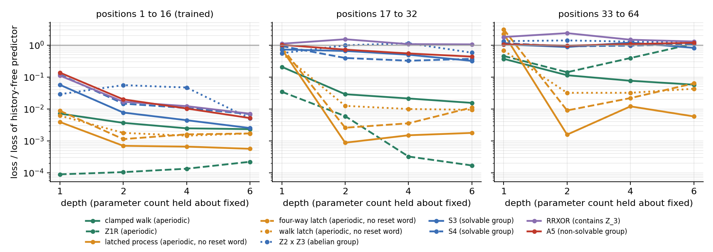

# Project A.2: what do trained transformers represent, and does the algebra predict length generalisation?

Two questions. Does a transformer trained to predict a process `p` encode a stretch of input by its
element of the monoid `S_p`, or only by the predictive state it leads to? And does the algebraic
class of `S_p` predict whether the model keeps working on histories longer than it was trained on?

Short answers, for these models:

1. **Only the state.** A linear readout of the element never beats what the predictive states
   and the literal symbols already give, at depths 4 and 6, in any process or seed. This is the
   null result the project plan named in advance.
2. **Aperiodic or not is what matters; solvable or not does not.** Models of the aperiodic
   processes keep predicting at twice the trained length (at four times, Z1R is erratic). Models of every group process do not, at
   any depth, and A5 is no worse than S3, S4 or Z2 x Z3. Training on four times the length does
   not change this.
3. **It is aperiodicity, not having a reset word.** Three processes that are aperiodic with no
   synchronising word (`act_latch`, `act_latch4`, `act_latchwalk`) generalise like the other
   aperiodic ones from depth 2.

This is length generalisation only. Nothing here measures grokking.

## Setup

- **Processes.** Eight "action" processes: a hidden point is moved by the observed symbol, and the
  probability of symbol 0 depends on the point, so the predictive states are the points and `S_p`
  is the monoid generated by the two maps. Plus Z1R and RRXOR. Sizes are computed exactly.
  `act_latch` separates two properties the others confound: it is aperiodic but no word resets it
  (minimum rank 2). The symbol after the first 0 picks one of two components, and inside a
  component the state is the last symbol. An aperiodic process with no reset word cannot be
  strongly connected, so a transient part of this kind is unavoidable (proved in Lean,
  `DovetailProofs/Predictor/Constant.lean`). `act_latch4` picks one of four
  components with two symbols (minimum rank 4). `act_latchwalk` picks one of two clamped walks on
  4 points (minimum rank 2), so the model must keep the choice and run a computation that depends
  on it. In all three the choice is made after the first 0, which the start point emits with
  probability 1/10: a random time, later than position 16 in about 19% of sequences.
- **Models.** Causal transformers trained at every position to predict the next symbol. Training
  sequences have 16 symbols, sampled afresh each step. Depths 1, 2, 4, 6 with widths 128, 92, 64,
  52 (about 2.0e5 to 2.1e5 parameters each). 4 seeds per process and depth: 160 models, 30,000
  steps each. A further 32 models are trained on 64 symbols (below).
- **Loss.** Exact KL divergence from the true next-symbol law, divided by the same for the best
  predictor that ignores the history. 0 is exact; 1 is no better than ignoring the input.

## Length generalisation



Median over seeds at positions 1-16 (trained) / 17-32 / 33-64:

| process | class of S_p | \|X_p\| | \|S_p\| | depth 1 | depth 2 | depth 4 | depth 6 |
|---|---|---|---|---|---|---|---|
| act_ap5 | aperiodic | 5 | 35 | 0.007 / 0.208 / 0.370 | 0.004 / 0.029 / 0.114 | 0.002 / 0.021 / 0.076 | 0.002 / 0.015 / 0.057 |
| z1r | aperiodic | 7 | 14 | 0.000 / 0.034 / 0.454 | 0.000 / 0.006 / 0.141 | 0.000 / 0.000 / 0.392 | 0.000 / 0.000 / 1.099 |
| act_latch | aperiodic, no reset word | 6 | 15 | 0.004 / 0.746 / 2.246 | 0.001 / 0.001 / 0.002 | 0.001 / 0.002 / 0.012 | 0.001 / 0.002 / 0.006 |
| act_latch4 | aperiodic, no reset word | 12 | 43 | 0.009 / 0.827 / 3.077 | 0.001 / 0.003 / 0.009 | 0.002 / 0.004 / 0.022 | 0.002 / 0.011 / 0.063 |
| act_latchwalk | aperiodic, no reset word | 10 | 71 | 0.006 / 0.553 / 0.670 | 0.002 / 0.012 / 0.032 | 0.001 / 0.010 / 0.032 | 0.002 / 0.009 / 0.043 |
| act_z6 | abelian group | 6 | 6 | 0.029 / 0.554 / 1.320 | 0.056 / 0.981 / 1.394 | 0.047 / 1.142 / 1.276 | 0.005 / 0.576 / 1.196 |
| act_s3 | solvable group | 3 | 6 | 0.057 / 0.723 / 1.052 | 0.008 / 0.654 / 0.868 | 0.004 / 0.497 / 1.196 | 0.003 / 0.319 / 0.813 |
| act_s4 | solvable group | 4 | 24 | 0.119 / 0.926 / 1.147 | 0.015 / 0.393 / 0.908 | 0.011 / 0.323 / 0.957 | 0.007 / 0.368 / 1.086 |
| rrxor | contains Z_3 | 36 | 73 | 0.111 / 1.100 / 1.785 | 0.017 / 1.517 / 2.355 | 0.012 / 1.066 / 1.465 | 0.007 / 1.049 / 1.290 |
| act_a5 | non-solvable group | 5 | 60 | 0.137 / 1.017 / 1.060 | 0.020 / 0.718 / 0.956 | 0.010 / 0.545 / 1.078 | 0.005 / 0.435 / 1.173 |

- At positions 17-32, 71 of the 80 aperiodic models are below 0.5 (median 0.012); the nine
  exceptions are latched processes at depth 1. Of the 64 group models, 25 are (median 0.57,
  minimum 0.28). Mann-Whitney p < 1e-16.
- **The three latched processes have no reset word and generalise anyway.** From depth 2, 34 of
  their 36 models are below 0.1 at positions 33-64 and 12 are below 0.01; the other two are at
  0.22 and 0.36. At depth 1 all three fail (median 0.55 to 0.83 at positions 17-32).
- At positions 33-64, no group model is below 0.73 and the median is 1.08.
- **The predicted gap between A5 and the solvable groups is not there.** At depths 2, 4 and 6 the
  A5 models and the solvable-group models cannot be told apart at either unseen range (p > 0.2 in
  all six comparisons). At depth 1, positions 17-32, A5 is worse (p = 0.01).
- Depth helps the group models at twice the trained length (about 0.9 at depth 1, about 0.4 at
  depth 6) and not at four times.
- **The line is aperiodicity of `S_p`, not a circuit class.** RRXOR's monoid contains Z_3, but no
  set of elements of words of one length contains a non-trivial group (`python -m
  predictive.equallength rrxor`), so the paper's lower bound does not apply to it. It can be
  predicted in AC^0: the state is a function of which of the three phases are consistent with the
  history, the length mod 3 and the last two symbols (checked against the exact machine for all
  possible words up to length 14). Its models fail like those of the groups all the same.
- Z1R at positions 33-64 varies across seeds from 0.002 to 2.4 with no trend in depth, so
  "aperiodic models generalise" holds cleanly only to twice the trained length for Z1R.

## Trained on 64 symbols

The clamped walk, S3, S4 and A5 retrained at depths 2 and 6 on 64 symbols, 4 seeds each,
evaluated to 256. Median at positions 1-64 / 65-128 / 129-256:

| process | class of S_p | \|X_p\| | \|S_p\| | depth 2 | depth 6 |
|---|---|---|---|---|---|
| act_ap5 | aperiodic | 5 | 35 | 0.001 / 0.149 / 0.553 | 0.001 / 0.048 / 0.340 |
| act_s3 | solvable group | 3 | 6 | 0.020 / 0.858 / 1.184 | 0.021 / 0.609 / 1.086 |
| act_s4 | solvable group | 4 | 24 | 0.060 / 0.703 / 0.925 | 0.037 / 0.659 / 1.110 |
| act_a5 | non-solvable group | 5 | 60 | 0.071 / 0.800 / 1.096 | 0.054 / 0.640 / 1.212 |

- Same split: at positions 65-128 every clamped-walk model is below 0.19 and every group model is
  above 0.37. At 129-256 the group models are at about 1.
- **No gap opens between A5 and the solvable groups** beyond the trained length (p > 0.4 in all
  four comparisons).
- Within the trained length the loss rises with the size of the group (0.02 for S3, 0.07 for A5
  at depth 2). That orders them by size, not by solvability.
- The clamped walk degrades too at four times this length (0.34 at depth 6).

## Element or state

For the last m symbols `w` (m = 6; 8 for A5 and RRXOR), a linear classifier reads the element
`tau_w` from the residual stream, best layer, fitted on half of 3,000 fresh sequences. Two
comparisons: the best guess from the predictive states before and after `w` ("from states"), and
the same classifier on a random regrouping of the words with the same class sizes ("regrouped").
The counterfactual readout asks for `tau_w(y)` at states `y` the process was not in.

Depth 6, medians over seeds (all depths are in [`a2.md`](a2.md)):

| process | classes | element | from states | regrouped | counterfactual | from states | regrouped | state readout | variance beyond state |
|---|---|---|---|---|---|---|---|---|---|
| act_ap5 | 20 | 0.90 | 0.89 | 0.72 | 0.95 | 0.95 | 0.75 | 0.99 | 0.04 |
| z1r | 3 | 1.00 | 1.00 | 0.63 | 1.00 | 1.00 | 0.69 | 1.00 | 0.00 |
| act_latch | 11 | 0.71 | 0.73 | 0.58 | 0.93 | 0.89 | 0.70 | 1.00 | 0.01 |
| act_latch4 | 30 | 0.62 | 0.66 | 0.58 | 0.91 | 0.89 | 0.72 | 0.97 | 0.01 |
| act_latchwalk | 39 | 0.65 | 0.70 | 0.61 | 0.89 | 0.89 | 0.70 | 0.93 | 0.01 |
| act_z6 | 6 | 0.59 | 1.00 | 0.47 | 0.63 | 1.00 | 0.51 | 0.97 | 0.02 |
| act_s3 | 6 | 0.63 | 0.70 | 0.67 | 0.81 | 0.69 | 0.80 | 0.98 | 0.01 |
| act_s4 | 12 | 0.43 | 0.62 | 0.44 | 0.62 | 0.62 | 0.61 | 0.94 | 0.07 |
| rrxor | 22 | 0.69 | 0.74 | 0.44 | 0.77 | 0.85 | 0.56 | 0.75 | 0.03 |
| act_a5 | 60 | 0.25 | 0.36 | 0.24 | 0.52 | 0.51 | 0.44 | 0.94 | 0.04 |

- The element readout never exceeds both comparisons by more than 0.02 at depths 4 and 6.
- One partial exception: A5 at depth 2, where the counterfactual readout is 0.65 against 0.52 for
  both comparisons (margin at least 0.11 in all four seeds). The margin is about 0.05 at depth 4
  and at most 0.04 at depth 6.
- Deeper models hold the state and little else: 1% to 7% of residual variance is not explained by
  the state at depth 6. Clustering the final residuals gives, for A5, S3 and Z2 x Z3 at depth 6, a
  deterministic automaton with one cluster per predictive state whose transition monoid has
  exactly |S_p| elements in every seed. For S4 and `act_latch` this holds in two seeds of four,
  and for the other processes in none. That is the machine itself, so it shows the state is
  tracked correctly, not that elements are stored.
- **Timing** ([`timing.json`](timing.json)): probing the checkpoints from step 500 onward, the
  element readout for the group processes at depths 4 and 6 is below the comparisons at every
  checkpoint. It is not built and then pruned. The A5 depth-2 margin grows through training.

## Not done, and limits

- **Causal interventions were not run.** They need a subspace that carries the element, and the
  readouts found none.
- The processes with no reset word all latch once: what no word erases is chosen at one (random)
  time and never changes. That is forced for an aperiodic process, but it means the experiment
  does not cover memories that are rewritten without ever being erased; those need a group.
- Readouts are linear. For act_z6 the element is a function of the two states, so that row cannot
  separate the hypotheses.
- Small models, two trained lengths (16 and 64), one optimiser setting, 4 seeds.

## Reproduce

```bash
python -m predictive.lengthgen sweep --out runs/a2
python -m predictive.lengthgen long --out runs/a2long
python -m predictive.monoidprobe runs/a2 --out results/a2 --timing
python -m predictive.a2report runs/a2 --probes results/a2/probes.json --long runs/a2long --out results/a2
```
